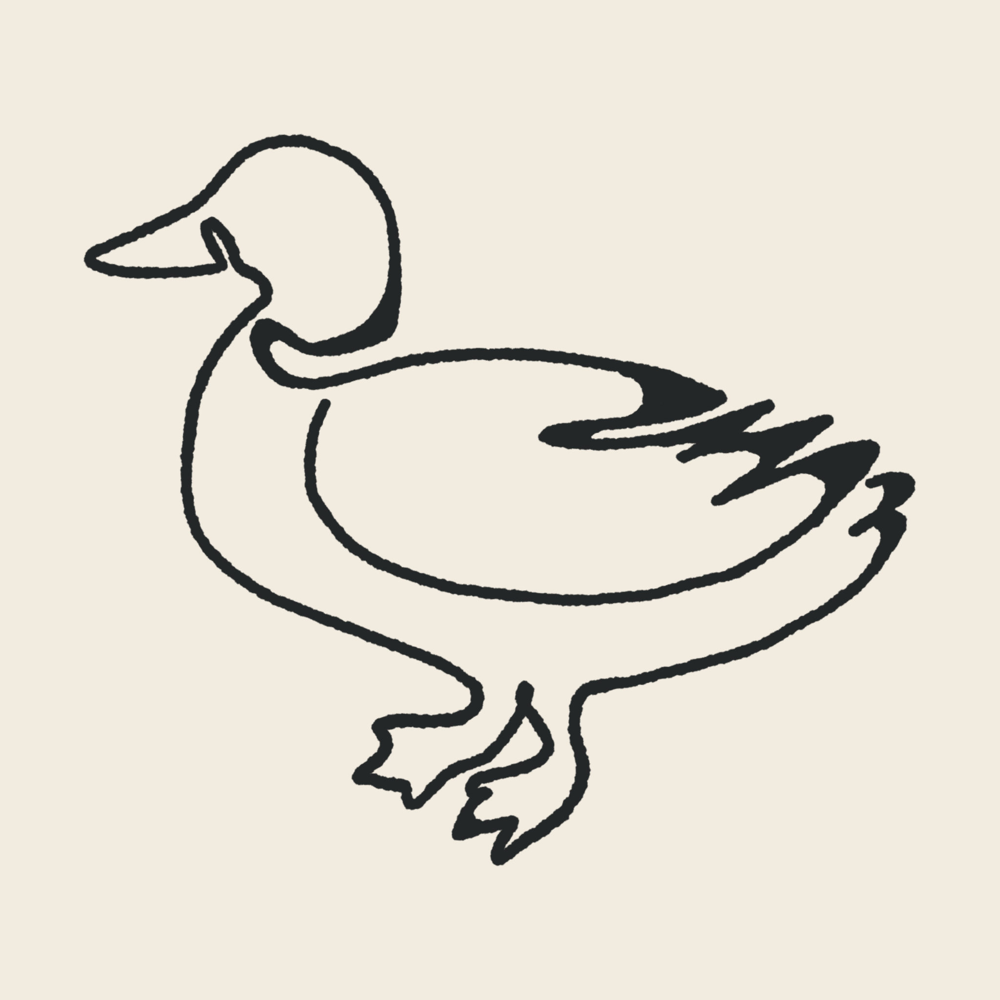

<p align="center"></p>

# Duck

A minimal PDF reader for macOS, built for reading papers. It has a small tagged library, a warm tan page color, and highlighting, and not much else.

Built with SwiftUI and PDFKit. No dependencies.

## Features

- **Tan pages.** Pages are tinted as they're drawn, so white paper becomes the same warm tan as the window. Black text stays black. Other page colors: Sepia, White, and Dark (light text on near-black, for night reading). The PDF files themselves are never changed.
- **Library.** Drag PDFs onto the window or press ⌘O to add them. Papers are copied into one library folder, which lives in iCloud Drive when it's available. PDFs you drop into the folder in Finder show up too.
- **Tags.** Give papers any number of tags. The sidebar lists each tag with a color dot and a count, and has views for Recent, All papers, and Untagged.
- **Reading.** Click a paper to open it in the main window, or right-click and choose Open in New Window. Each paper reopens on the page you left off.
- **Highlights.** Select text and press ⌃⌘H. Press it again over a highlight to remove it. Highlights are stored in the library, not in the PDF.
- **Find.** ⌘F searches the open paper, with a match count and next/previous. With no paper open, it filters the library.
- **Zoom.** ⌘+, ⌘−, and ⌘0 (fit width).

## Keyboard shortcuts

| Shortcut | Action |
| --- | --- |
| ⌘O | Add papers |
| ⌘F | Find in paper, or search the library |
| ⌃⌘H | Highlight the selection (or the current search match), or remove highlights it overlaps |
| ⌘+ / ⌘− / ⌘0 | Zoom in / zoom out / fit width |
| ⌘[ | Back to the paper list |
| ⌃⌘S | Show or hide the sidebar |

## Requirements

- macOS 26 or later
- Xcode 26 or later to build

## Building

Open `Duck.xcodeproj` in Xcode and press ⌘R.

From the command line:

```sh
xcodebuild -project Duck.xcodeproj -scheme Duck -configuration Release -derivedDataPath build build
```

The app is written to `build/Build/Products/Release/Duck.app`. To install it:

```sh
ditto build/Build/Products/Release/Duck.app /Applications/Duck.app
```

The app is signed ad hoc for local use and isn't sandboxed, so it can reach the library folder in iCloud Drive without extra entitlements. You don't need a developer account to build and run it on your own Mac.

## Where your data lives

Everything is in one folder:

- `~/Library/Mobile Documents/com~apple~CloudDocs/Duck Library/` when iCloud Drive is on
- `~/Documents/Duck Library/` otherwise

The folder holds your PDFs plus a `library.json` with each paper's tags, last-read page, last-opened date, and highlights:

```json
{
  "Some Paper.pdf" : {
    "added" : "2026-11-19T18:49:04Z",
    "highlights" : [ { "page" : 0, "rect" : [ [ 72, 640 ], [ 200, 14 ] ] } ],
    "lastPage" : 4,
    "opened" : "2026-11-19T20:10:00Z",
    "tags" : [ "ml", "to-read" ]
  }
}
```

If `library.json` can't be read, Duck shows an error and stops saving tags and highlights for that session, rather than overwrite the file.

To point Duck at a different folder (handy for testing), launch it with `-libraryPath`:

```sh
/Applications/Duck.app/Contents/MacOS/Duck -libraryPath ~/Desktop/test-library
```

## Logging

Duck logs to the macOS unified log under the subsystem `local.duck.reader`. Entries include errors (adding, renaming, trashing, saving, PDFs that won't open, iCloud downloads that fail) and the library folder and paper count at launch.

In **Console.app**, start streaming and search for `subsystem:local.duck.reader`.

From Terminal:

```sh
/usr/bin/log show --last 1h --predicate 'subsystem == "local.duck.reader"'
/usr/bin/log stream --predicate 'subsystem == "local.duck.reader"'
```

Use the full `/usr/bin/log` path in zsh, which has its own built-in `log` command.

## Project layout

| File | Purpose |
| --- | --- |
| `Duck/DuckApp.swift` | App entry point, windows, and menu commands |
| `Duck/Library.swift` | Library folder, `library.json`, tags, highlights, iCloud downloads |
| `Duck/LibraryView.swift` | Main window: sidebar, paper list, breadcrumb, tag and rename sheets |
| `Duck/ReaderView.swift` | Reader: PDF view, find bar, highlighting, zoom |
| `Duck/PageTint.swift` | Page colors and the page drawing that tints them |
| `Duck/Theme.swift` | Window palette and button styles |
| `Duck/Log.swift` | Loggers |

## Known limitations

- **Tall text selections in some PDFs.** A few PDFs declare fonts much taller than their letters, and PDFKit draws the mouse selection at that size. Duck trims highlights and search matches back to the text, but the selection itself can't be resized. Preview shows the same box for these files.
- **Highlights made by other apps** are shown but can't be removed in Duck, because removing them would mean rewriting the PDF.
- **No iOS app yet.** The library folder and `library.json` are set up so an iOS version can share them later.
